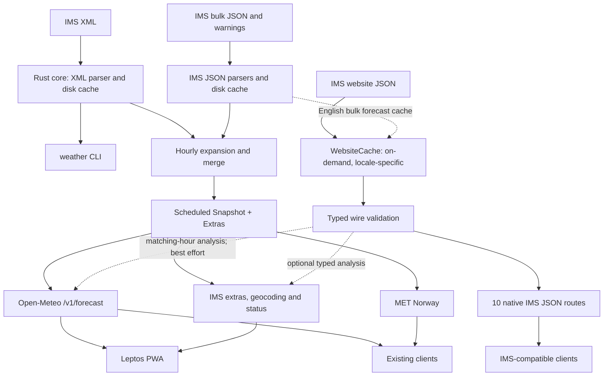
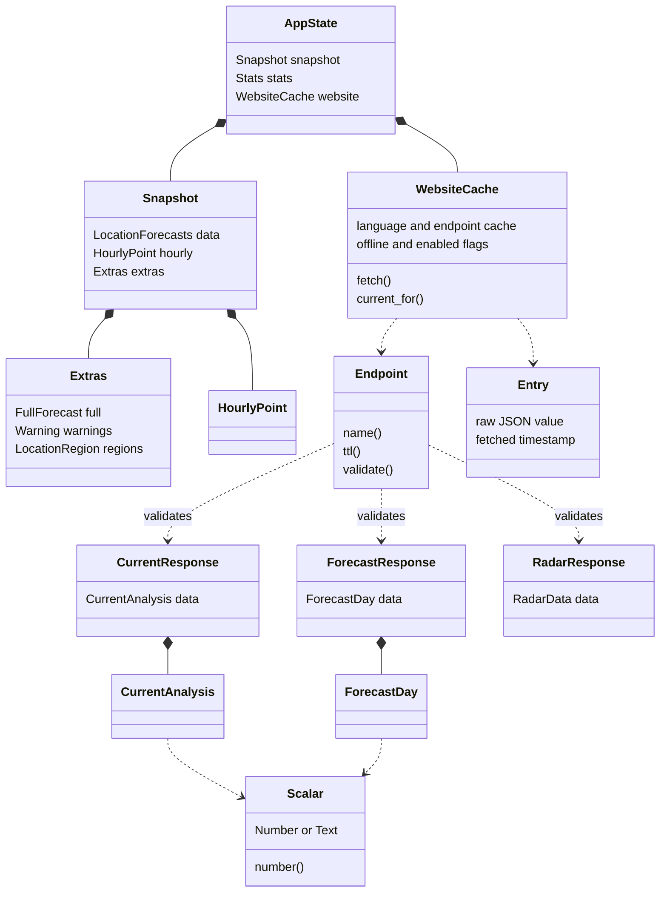
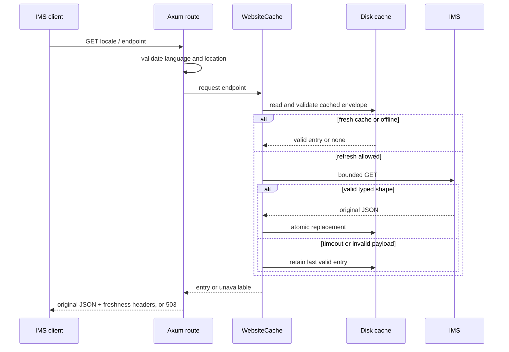

# Architecture specification

Status: implementation in [PR #50](https://github.com/barakplasma/israel-weather-rs/pull/50); native website wire contracts remain provisional pending live IMS verification. Based on [Matt Pocock's to-spec](https://github.com/mattpocock/skills/tree/main/skills/engineering/to-spec), adapted to repository documentation.

## Problem Statement

Israeli weather users need a reliable, cache-first service for CLI, browsers and existing weather clients. New IMS website features should be accessible without compromising the established APIs or requiring Python.

## Solution

Keep the scheduled forecast snapshot as the primary read model. Add an independent, typed, on-demand website compatibility layer. Use optional current analysis to enrich compatible existing current-weather fields; errors, unavailable or mismatched cached data and timeouts must retain the original forecast. Offline mode may enrich using matching-hour cached analysis without network access.

## User Stories

1. As a CLI user, I want locally cached forecasts so that IMS outages do not stop my alerts.
2. As a weather API consumer, I want existing Open-Meteo and MET Norway paths and response shapes to remain stable.
3. As a PWA user, I want the same normalized forecasts, warnings and location search without additional required network calls.
4. As an IMS client developer, I want native current analysis, daily/hourly forecast, warnings, radar manifests and dictionaries in Hebrew or English.
5. As a Rust developer, I want typed wire models and generated OpenAPI schemas for known IMS fields.
6. As a client developer, I want unknown fields and numeric-string sentinels preserved on the compatibility routes.
7. As an operator, I want bounded downloads, cache isolation, stale fallback and freshness headers.
8. As an existing current-weather client, I want fresher compatible values when available, with per-field fallback and unchanged units.
9. As an IMS extras client, I want additional current analysis fields such as PM10 and wave height when available without losing the existing response.
10. As an offline user, I want the existing snapshot without any new remote requests.
11. As a maintainer, I want fixtures and behavioral API tests so upstream changes are detectable.

## Implementation Decisions

### Major Rust components

- The root Rust library owns XML parsing, location lookup and time normalization; hourly logic overlays native JSON on interpolated XML. The CLI uses the core without requiring HTTP.
- Axum refreshes snapshots on the configured schedule; normalized Open-Meteo, MET Norway, IMS extras, geocoding, health/status and embedded UI read existing state. The shared weather-api crate supplies server/PWA DTOs.
- WebsiteCache isolates language, endpoint and location keys, validates data before replacing disk entries, bounds response sizes, and performs blocking work off the async executor. A shared gate and retry backoff bound work. English per-location forecast may reuse the scheduled bulk cache.
- Endpoint-specific Serde types validate the known shapes of all ten native JSON routes. The server returns the original Value, not a reserialized typed projection; unknown keys, number-vs-string representation, nulls and sentinels survive. The models are partial contracts, not proof of exhaustive upstream schemas.
- Current analysis can overlay compatible temperature, humidity, dew point, apparent temperature, wind speed/gust and UV onto the existing Open-Meteo current/current_weather point only for fresh, matching-hour records online; offline may use TTL-expired cached records from the same hour. Unit conversion stays with existing handlers. Missing or out-of-range fields retain the forecast. Hourly/daily forecasts and MET Norway forecast semantics are unchanged. Rain accumulation, codes and wind direction are not replaced until semantic equivalence is verified.
- The existing IMS extras endpoint may include a typed current_analysis object, omitted entirely if no eligible cached or live record exists. Existing fields are unchanged.
- Best-effort enrichment uses a one-second wait budget; if busy, unavailable, disabled, stale online, mismatched or timed out, the original response wins. Offline mode never makes network requests and may use matching-hour cached data even after the refresh TTL. A started bounded refresh can finish and warm the cache.
- No PyO3 or new runtime dependency.

### Native request and fallback

## Testing Decisions

Prefer the existing Axum router and fixture seams, not tests of private implementation details. Test native envelopes, locale isolation, offline cache enrichment and fallback, malformed known fields, unknown fields, current-time alignment and per-field enrichment; retain the existing Open-Meteo/MET Norway client suite and web/CLI tests. Use synthetic or existing captured fixtures; live checks remain opt-in. CI must pass formatting, clippy, unit tests, release build and compatibility tests.

## Out of Scope

Python bindings, image downloading/animation, new dependencies, altering MET Norway forecast semantics, unsupported current analysis fields and full live wire-compatibility claims.

## Further Notes

See [IMS website API reference](ims-website-api.md) for upstream shapes and licensing, and [Python binding plan](python-bindings.md) for deferred work.
