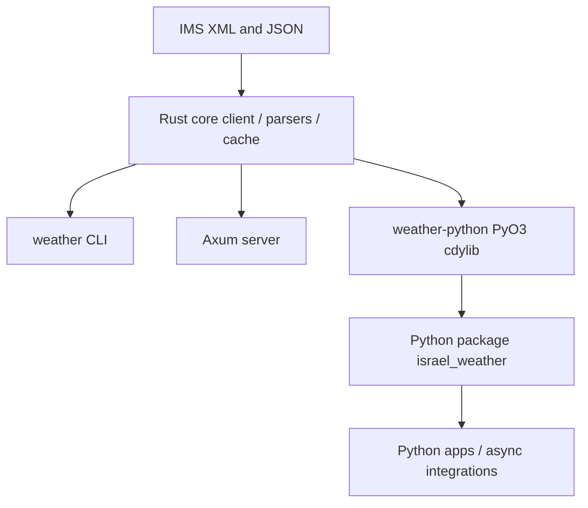

# Native Python bindings (PyO3 + Maturin)

Status: proposed implementation, not shipped. Goal: use the same Rust IMS client, parsers, persistent cache and offline logic directly from Python without subprocesses, HTTP server or duplicated scraper.

Reference: [py-weatheril](https://github.com/t0mer/py-weatheril/tree/76ab1d577d7a5336bbf55e7fab42d27c2f361f0d) exposes WeatherIL(location, language="he", cache_expiration_in_sec=30), get_forecast(), get_current_analysis(), get_warnings(), get_radar_images(). Its API is inspiration, not a dependency; see [IMS endpoint reference](ims-website-api.md).

## Architecture



Current Cargo workspace has root library/binary israel-weather-rs, crates/weather-api for DTOs and web for wasm. Core uses blocking reqwest 0.12 and cached-path; server feature pulls Axum/Tokio and build.rs requires embedded web assets. Keep server disabled for wheels. Start with path dependency on the root library (default-features=false); do not depend on the server module's Snapshot or duplicate parser logic. Extract a shared library-only Client/Snapshot if needed instead of enabling server. Keep web/default-members behavior unchanged.

## Phase 1: shared core

- Introduce ClientConfig with base URL, XML URL, cache directory, language, offline, cache TTL and timeouts. Instance-scoped settings; preserve environment-backed CLI defaults. Reuse existing get_israeli_weather_forecast, ims_json::fetch/parse_full_forecast, parse_location_regions, parse_warnings, and hourly::merge_hourly. Move reusable snapshot assembly and location lookup out of the feature-gated server.
- Define Rust methods for refresh, locations, forecast by lid/name/coords, warnings. Add current analysis and radar following the IMS spec. Prefer Result and typed errors, optional values and source/freshness metadata. Share cache implementation with CLI/server without requiring a running service.
- Tests against shared fixtures and local mock server before binding work.

## Phase 2: binding crate and Python package

Add `crates/weather-python/` to workspace members (not default-members initially), with Cargo.toml, src/lib.rs, python/israel_weather/__init__.py, python/israel_weather/py.typed, type stubs and tests. Place pyproject.toml in the binding crate; keep workspace Cargo.lock and path dependencies in scope. Proposed distribution name `israel-weather-rs` and import `israel_weather`; verify PyPI name availability before publishing. Use `cdylib` extension module named `_native`, a compatible stable PyO3 version and the official Maturin build backend; initially target stable ABI (abi3-py310). Maturin is build-time only. Keep dependency versions pinned through lock files; validate current PyO3/maturin docs before choosing versions. No unsafe code in handwritten binding logic. Root package forbids unsafe_code; retain that.

Preferred no-Maturin packaging design (illustrative; validate once the binding crate exists):

```toml
# Root pyproject.toml
[build-system]
requires = ["setuptools", "wheel", "setuptools-rust>=1.12"]
build-backend = "setuptools.build_meta"

[project]
name = "israel-weather-rs"
requires-python = ">=3.10"
# Supply version and license metadata from Cargo in the release process.

[tool.setuptools.packages.find]
where = ["crates/weather-python/python"]

[[tool.setuptools-rust.ext-modules]]
target = "israel_weather._native"
path = "crates/weather-python/Cargo.toml"
binding = "PyO3"
features = ["pyo3/abi3-py310"]
```

Set stable wheel tags as well as the Rust ABI. For a local build, use `python -m build --wheel --config-setting=--build-option=--py-limited-api=cp310` (setuptools-rust documents this option). For cibuildwheel use the equivalent build config setting; explicitly assert cp310-abi3 tags. Test the result on multiple CPython versions. Do not promise free-threaded compatibility. Keep the extension build configuration separate from ordinary Rust tests; no Maturin required.

PyO3 boundary should be thin: `#[pyclass]` client owning Arc<CoreClient>, `#[pymethods]`, `#[pymodule]`, convert DTOs to typed Python models or dictionaries. Start with typed Python dataclasses or TypedDicts and generated/maintained stubs; avoid JSON text as the primary API. Return timezone-aware datetime, float/int, None, collections; never NaN/missing-as-zero. Map invalid input to ValueError, unavailable data to a dedicated WeatherUnavailableError, parse/transport to documented subclasses. Release GIL around blocking Rust I/O and computation (modern PyO3 Python::detach; check exact version), reacquire for Python object construction; no Python references across detached operations. Use bounded concurrent access to cache and avoid lock inversion. Do not claim free-threaded CPython support before testing.

Illustrative public API, names subject to review:
```python
from israel_weather import Client

client = Client(language="en", cache_dir="/tmp/ims-cache", offline=False)
client.refresh()
places = client.locations()
forecast = client.forecast(location_id=2)
current = client.current_analysis(location_id=2)
warnings = client.warnings(location_id=2)
radar = client.radar_images()
```

For Python async apps provide a thin asyncio.to_thread wrapper over the synchronous API, not a second Rust Tokio runtime. Later, optionally offer a WeatherIL-style adapter with get_forecast/get_current_analysis/get_warnings/get_radar_images and explicit compatibility tests; use distinct import name, do not impersonate the weatheril distribution or promise drop-in behavior before testing. A separate pure Python remote HTTP client can be considered later but is not the requested native binding.

## Phase 3: build, test, publish

- Local developer flow: create venv, install maturin and pytest, cd crates/weather-python, maturin develop, pytest tests. cargo test -p israel-weather-rs remains independent.
- Build wheels for Linux x86_64 and aarch64 (manylinux), macOS arm64/x86_64 and Windows x64 as CI capacity permits; prioritize Linux ARM64 and x86_64. Test supported CPython versions from 3.10 onward, including newest tested stable release. Test wheel installation in clean environments, not only an editable install. No compiler or Rust required at runtime.
- Current reqwest default-tls uses native OpenSSL on Linux and vendored OpenSSL for arm/aarch64 in root Cargo.toml. Verify manylinux/auditwheel linkage, CA cert handling, and wheel size; choose portable TLS packaging if necessary without breaking Android CLI. Current Rust MSRV 1.98 requires an appropriate toolchain; verify runner availability rather than lowering silently. Build sdist with workspace path dependencies included or defer sdist until tested.
- CI: dedicated Python wheel workflow (see concrete matrix below), fixture-based pytest for current/forecast/warnings/radar, language isolation, stale/offline, typed errors, DST, threading/GIL smoke test, parity with core Rust fixtures and existing Rust/API tests. Test optional web/server feature separately. Add package README and examples, licensing/third-party notice and wheel metadata. Publish via PyPI trusted publishing on tagged releases only after successful clean install; test on TestPyPI first if desired. No credentials in repo.
- Canonical references: [PyO3 guide](https://pyo3.rs/), [building and distribution](https://pyo3.rs/main/building-and-distribution), [Maturin distribution](https://www.maturin.rs/distribution), [official PyO3/maturin-action](https://github.com/PyO3/maturin-action). No third-party agent skill required.

### Minimal GitHub Actions workflow

Once the native crate exists, run the official workflow generator:

```sh
maturin generate-ci github -m crates/weather-python/Cargo.toml
```

Use its generated output as the starting point. The simplest initial workflow (.github/workflows/python-wheels.yml, example only, not executed):

```yaml
name: Python wheels
on: [push, pull_request, workflow_dispatch]
permissions:
  contents: read
jobs:
  wheels:
    strategy:
      fail-fast: false
      matrix:
        include:
          - runner: ubuntu-latest
            target: x86_64
          - runner: ubuntu-24.04-arm
            target: aarch64
          - runner: macos-latest
            target: aarch64
          - runner: windows-latest
            target: x86_64
    runs-on: ${{ matrix.runner }}
    steps:
      - uses: actions/checkout@v5
      - uses: actions/setup-python@v6
        with:
          python-version: '3.10'
      - uses: PyO3/maturin-action@v1
        with:
          target: ${{ matrix.target }}
          manylinux: auto
          rust-toolchain: '1.98'
          args: --release --locked --manifest-path crates/weather-python/Cargo.toml --out dist
      - name: Install and test built wheel
        shell: bash
        run: |
          python -m pip install pytest
          python -m pip install dist/*.whl
          python -m pytest crates/weather-python/tests
      - uses: actions/upload-artifact@v4
        with:
          name: wheels-${{ matrix.runner }}-${{ matrix.target }}
          path: dist/*.whl
```

Verify native runner architectures, interpreter selection and OpenSSL linking inside the Linux manylinux build. Use generated platform-specific jobs if needed. Pin reviewed action commits for production and update via Dependabot. Test exact wheels on native runners with offline fixtures; add latest stable CPython install tests and macOS x86_64 as needed. Initially upload CI artifacts, then extend existing release workflow to attach wheels and optionally publish to PyPI using trusted publishing. No separate cibuildwheel or custom packaging scripts. Keep Axum server disabled in wheels.


## Milestones and acceptance

1. Core extraction + fixture parity: CLI/server unchanged; no PyO3 in default build.
2. Minimal native wheel: import Client, locations and forecast; offline fixture tests with no HTTP server. Confirm wheel works on Linux x86_64 and aarch64.
3. Expanded bindings: current analysis, warnings, radar/metadata, cache freshness and async wrapper. Same Rust behavior as local HTTP server.
4. Distribution: typed package, documented error semantics, installation tests and opt-in publish.
5. Optional compatibility/collaboration: compare fixture behavior with py-weatheril; share endpoint discoveries upstream and propose a compatibility adapter only if maintainers/users want it.

Success means one source of truth in Rust and a pip-installable native client, not a rewrite of py-weatheril in Python or a mandatory self-hosted service.
