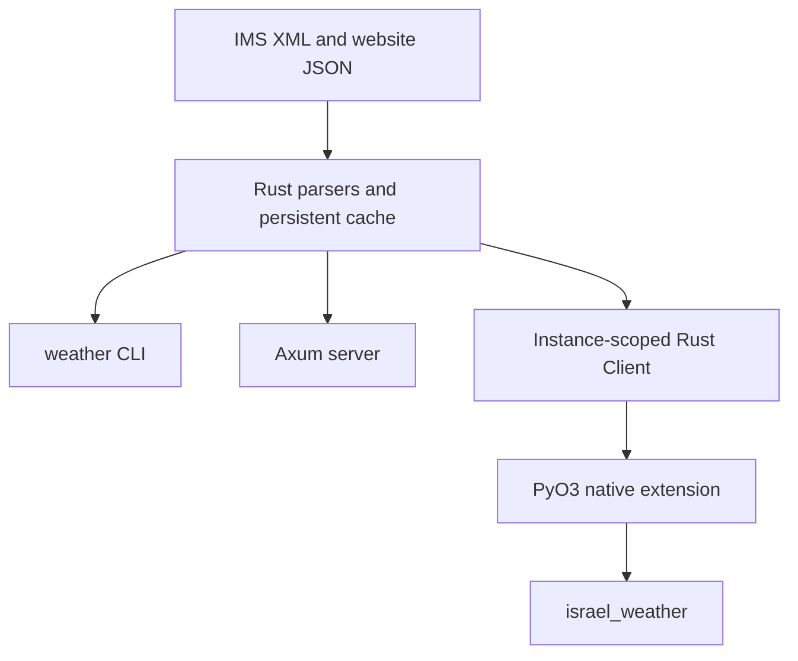

# Native Python bindings (PyO3 + Maturin)

Status: prerelease candidate; CI must pass before distribution.

The synchronous cache store is shared by the native client and server; both use the existing parser/validation logic. The native crate is isolated from the default Rust workspace and disables the server feature. Client settings are instance-scoped: locale, cache directory, offline flag and upstream URLs. No process environment changes.

The client exposes refresh(), locations(), forecast(location_id), current_analysis(location_id), warnings(), radar_images() and website(endpoint, location_id=None). Normalized forecast uses XML expansion and the existing merge algorithm, with XML fallback. Native requests return payload, fetched_at and stale. The native warning envelope is unfiltered; radar is a manifest. Ordinary Python dictionaries/lists, typed stubs and ISO timestamps are provided. The GIL is released during blocking Rust operations.

## Distribution and tests

Official PyO3/maturin-action builds cp310-abi3 wheels on Linux x86_64 and ARM64, macOS ARM64 and Windows x64. CI checks wheel metadata, clean installation, pip dependencies, fixture parity, threading, offline fallback, locale isolation and unknown field preservation on Python 3.10 and 3.14. Artifacts are attached to a release only after all platform jobs pass. No automatic PyPI publishing. Separate lockfile should be committed once CI resolves it. See [official PyO3 guide](https://pyo3.rs/) and [Maturin](https://www.maturin.rs/).

Future: filtered warnings, richer native Python payload stubs, datetime objects, macOS Intel, and an optional py-weatheril adapter.
